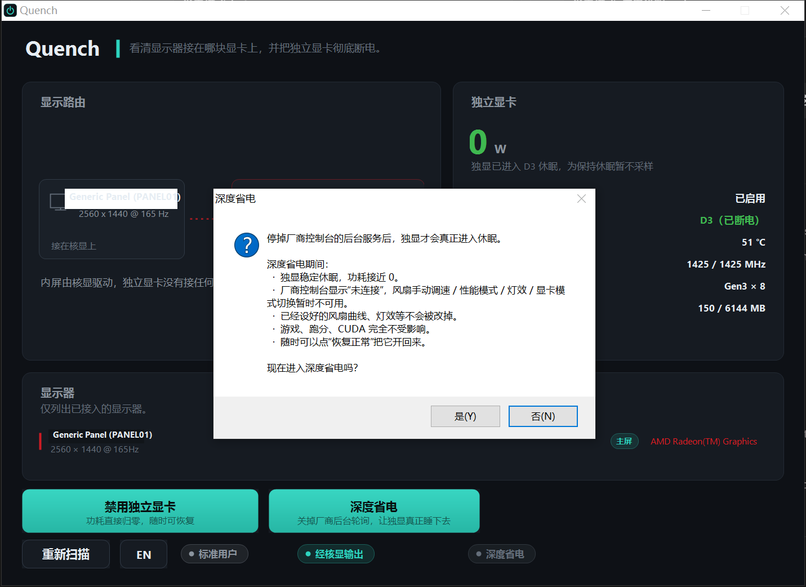
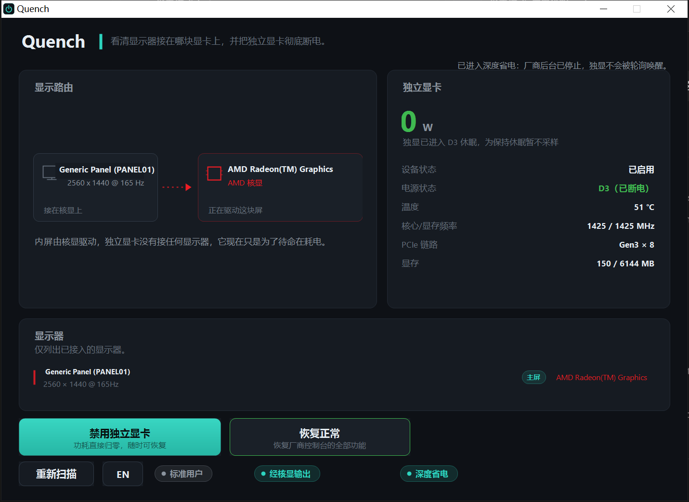

# Quench

**See which GPU your display is wired to — and cut power to the discrete one.**

English | [简体中文](README.zh-CN.md)

Quench is a single-file Windows utility for laptops with switchable graphics. It tells
you, at a glance, whether the built-in panel is driven by the integrated GPU or wired
straight to the discrete GPU, how much power the discrete GPU is really drawing, and it
can get that GPU to a true 0 W — either by silencing the vendor control centre that keeps
waking it up, or by disabling the device outright. No BIOS trip, no reboot.


## Why

On a hybrid-graphics laptop the discrete GPU is not off just because nothing is
rendering on it. It parks in a low-power state and keeps sipping power — roughly
**10–30 W** in its lowest performance state, even with no display attached — and bursts
to **25–40 W** whenever a browser tab, a game launcher or the vendor app touches its
context, even if that app is doing nothing useful with it. Between those touches the GPU
does drop to D3 on its own, but anything that polls it drags it straight back out.

Windows has no supported way to say "use the integrated GPU only" from the desktop.
The firmware setting is usually binary (hybrid ⇄ discrete), so the only way to reach a
true dGPU-zero state without a reboot into the BIOS is to disable the device — which is
exactly what vendor control centres do internally, and what Quench does with a click.

## What it shows

- **Display routing** — a diagram of every attached monitor and the GPU actually
  driving it, read from `EnumDisplayDevices` plus the EDID, so it reflects the real
  wiring rather than a driver-reported preference.
- **Live board power** — real wattage read through NVML, the same source `nvidia-smi`
  uses, but without needing an elevated prompt.
- **Device and power state** — enabled/disabled, and whether the GPU is sitting in D0
  or has dropped to D3.
- **Temperature, clocks, PCIe link, VRAM** — for context while gaming.

## What it does

Two things, and they solve different halves of the problem.

**Deep sleep** is the one that actually gets the card to idle at zero. On a hybrid laptop
the discrete GPU is not off just because nothing is drawing on it: vendor control centres
(a.k.a. gaming dashboards) poll the card every couple of seconds to paint their own
readouts, and every poll pulls it straight back out of D3. Measured on a normal hybrid
machine, only **20–30 %** of the time was spent asleep with the vendor service running,
versus **100 %** with it stopped. Deep sleep stops that background service stack and puts
its start type back to manual, so the GPU stays down across reboots too. Click
**Back to normal** and everything the vendor utility does comes back.

**Disable discrete GPU** is the blunt instrument: it turns the device off through the
Windows SetupAPI class installer, the same mechanism Device Manager uses. Fully reversible,
no reboot, no driver reinstall, no BIOS trip. While disabled the GPU draws **zero** power.
The internal panel keeps working when it is wired to the integrated GPU; anything physically
wired to the discrete GPU — external HDMI/DisplayPort outputs on most gaming laptops — goes
dark until you re-enable it.

Which one you want depends on the machine. If the panel is wired to the discrete GPU (MUX
in "discrete only" mode) the card must keep scanning it out, so it can never sleep and
disabling it just leaves Windows with no driver for the panel. Put the MUX back to hybrid
first, then use deep sleep.

## Screenshots

| Enabled, ready | Disable confirmation | Disabled — 0 W |
| --- | --- | --- |
|  |  |  |

| Deep sleep offer | Deep sleep confirmation | Deep sleep on — 0 W |
| --- | --- | --- |
|  |  |  |

## Requirements

- Windows 10 or 11, 64-bit
- .NET Framework 4.8 (present on every supported Windows 10/11 install)
- NVIDIA discrete GPU for the live power telemetry; the routing diagram and the
  enable/disable button work for any vendor

## Download

Grab `Quench.exe` from the [latest release](releases/latest). It is a single
self-contained executable — no installer, no dependencies, nothing to unzip.

## Usage

Double-click `Quench.exe`. The window opens on the current routing and power state.

- **Disable discrete GPU** — asks for confirmation, then disables the device. Windows
  shows a UAC prompt because changing a device's state requires administrator rights;
  Quench relaunches itself elevated and does the work.
- **Enable discrete GPU** — puts it back, same one-click path.
- **Deep sleep / Back to normal** — stops (or restarts) the vendor control centre's
  background service. Only offered when a known vendor service is present. The pill at
  the bottom lights up while it is on.
- **EN / 中文** — switches the interface language.

The window refreshes by itself. It deliberately does not poll the GPU constantly: reading
NVML wakes the GPU out of D3, and a tool that measures idle power should not be the
reason the GPU never idles. When the GPU is asleep, Quench shows `0 W` and says so
instead of waking it up to take a reading.

### Command line

For scripting, the same executable has a headless mode:

```
Quench.exe --status        # print the current device state
Quench.exe --disable       # disable the discrete GPU
Quench.exe --enable        # enable it again
Quench.exe --quiet-status  # is the vendor service stack stopped?
Quench.exe --quiet-on      # stop it (deep sleep)
Quench.exe --quiet-off     # start it again
```

These run elevated and write their result to `quench-result.txt` next to the executable.

## How it works

| Need | Mechanism |
| --- | --- |
| Which GPU drives which display | `EnumDisplayDevices` + `EnumDisplaySettings`, EDID parsed from the registry for the monitor name |
| Live power, temperature, clocks | `nvml.dll` via P/Invoke, with an adaptive sampling policy so it does not pin the GPU awake |
| Device state | `CM_Get_DevNode_Status`, `CM_PROB_DISABLED` |
| D0/D3 power state | `DEVPKEY_Device_PowerData` (`SetupDiGetDeviceProperty`) |
| Disable / enable | `SetupDiSetClassInstallParams` + `SetupDiCallClassInstaller(DIF_PROPERTYCHANGE)` |
| Deep sleep | `ServiceController` + the service's `Start` registry value, then terminating its helper processes |

Nothing is installed, no service is created. The only persistent changes are the device's
own enabled/disabled flag and — while deep sleep is on — the vendor service's start type,
which Quench remembers and puts back when you switch it off.

## Building

The project is plain C# with no NuGet packages and no SDK-style project file, so it
builds with the C# compiler that ships with the .NET Framework:

```bat
build.bat
```

To build by hand:

```bat
csc.exe -nologo -target:winexe -out:Quench.exe -platform:anycpu -optimize+ ^
  -r:System.dll -r:System.Drawing.dll -r:System.Windows.Forms.dll -r:System.Core.dll -r:System.ServiceProcess.dll ^
  -win32icon:assets\quench.ico ^
  src\AssemblyInfo.cs src\Program.cs src\Native.cs src\Theme.cs src\Loc.cs ^
  src\DisplayTopology.cs src\GpuDevice.cs src\Nvml.cs src\Elevation.cs ^
  src\Headless.cs src\UiControls.cs src\MonitorList.cs src\PowerSave.cs ^
  src\MainForm.cs
```

Source files use UTF-8 with a BOM. Keep the BOM when editing — the compiler and
Windows tooling will otherwise read the Chinese strings as ANSI.

## Notes and limits

- Disabling the discrete GPU is a system-wide change. If you have an external monitor
  plugged into an output that belongs to the discrete GPU, it will turn off.
- Some laptops route an external HDMI/DisplayPort through the integrated GPU even in
  hybrid mode; those keep working.
- Switching the *panel* between GPUs is a firmware (MUX) job. Quench reports the current
  routing but cannot change it — that still needs the BIOS or the vendor utility.
- Resuming from sleep, driver updates or a BIOS update can re-enable the device. Just
  press the button again.
- Disabling removes the device from the driver stack, but it does not remove it from the
  PCI bus: Device Manager still lists it, greyed out with a "disabled" code. That is
  normal; the card itself sits in D3 and its driver is unloaded.
- Whole-machine draw is dominated by the CPU, the panel (high refresh rate at full
  brightness is expensive) and whatever else is running. Quench only accounts for the
  discrete GPU's own share — measure the wall socket, not the app, if you want the total.
- While deep sleep is on, the vendor control centre reports itself as disconnected: fan
  curves, performance modes, lighting and GPU-mode switching are unavailable. Settings you
  already saved are kept, and games, benchmarks and CUDA are unaffected.
- Deep sleep only knows about a small set of vendor service stacks (currently the
  Uniwill-based "GCU" control centre used by several gaming laptop brands). On other
  machines the button is hidden rather than guessing at service names it should stop.
- Developed and verified on a hybrid-graphics laptop (AMD iGPU + NVIDIA dGPU, Windows 10
  64-bit). Other hybrid laptops should behave the same way, but the routing detection is
  the part most likely to need tweaks on unusual hardware — issues with your `--status`
  output are welcome.

## License

MIT — see [LICENSE](LICENSE).
